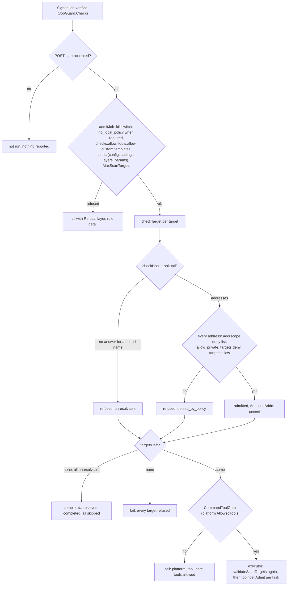
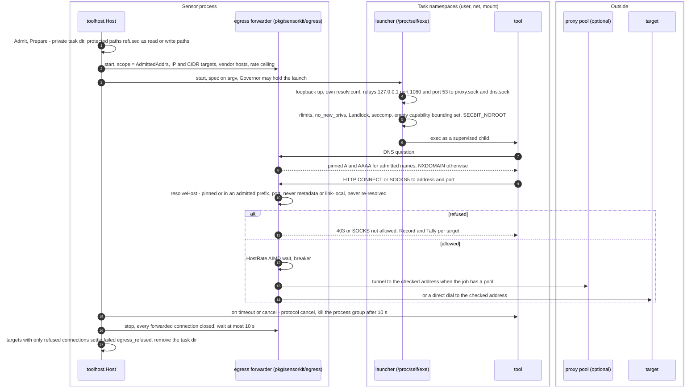

# SDK Security Guide

This document describes the security features and best practices for the OpenCTEM SDK.

---

## Security Features

### 1. Credentials

A tool declares the secrets it needs in its tool contract (`pkg/tool`). The
runtime passes a tool only the settings the scanner environment allowlist
names (`pkg/core/scanner_env*.go`) and never writes a secret into a task or a
log. The SDK keeps no credential store of its own.

Where a tool's credentials come from (contract `secretref`):
- **The organization (platform jobs).** When a sensor claims a job, the
  platform lists in the job's payload (member `secrets`) the secret refs the
  job may use: ids, kinds, the stored value each names, the tool slot it
  fills, where its value may be sent (its audience) and the slot's local
  policy. The list is part of the signed job; the sensor reads it only from
  a job whose signature it verified (`core.JobSecretsFor`) and refuses a
  job that requires a kind it does not know (`secret_kind_unsupported`).
  A job whose signature was not verified (the sensor pins no job signer,
  posture `jobs.signed: off`, or an unsigned job on a
  `verified_when_present` sensor) never gets platform values: when its list
  requires a secret, or when its list is present but cannot be read, it is
  refused before it starts (`secrets_unverified`, naming the fix), so a proxy-pool or authenticated job
  never runs without its credentials; optional refs are left out and the
  job's log says how many.
  For each task, the tool host fetches the refs of the slots the tool's
  manifest declares (`client.Secrets`:
  `POST /api/v2/sensor/commands/{id}/secrets`, v2 HTTPS only). The request
  is signed by the sensor's key-bound identity (a bearer-key client never
  fetches) and carries the lease epoch and a single-use HPKE public key in
  its signed body; the answer is sealed to that key (ML-KEM-768+X25519,
  HKDF-SHA256, ChaCha20-Poly1305) under an info that binds the sensor, the
  command, the epoch and the exact request bytes, so a TLS terminator, a
  request log or a replayed request never holds a value. The sensor checks
  the opened answer against the job's list (command, epoch, only refs it
  asked for, each value valid for its kind), drops the key, and keeps
  nothing across tasks.
- **The operator** (`sensorkit.Options.ToolCredentials`). Per slot the
  organization's value wins; the operator's value fills a slot only when
  the signed list's local policy allows it (`allow`, or `only`, which never
  asks the platform). A shared sensor never uses an operator's value for
  an organization's task, whatever the job says (its own identity forces
  `never`), and passes no vendor environment namespace (`PDCP_*`,
  `TRIVY_*`, ...) to such a task. Outside a platform job the operator's
  values are used as before (an organization's sensor only).

No fallback: a fetch that fails, any non-200 answer (a gateway 404
included) or an answer that does not open or check gives no platform value,
and the operator's value only where the signed policy allows it. A required
slot without a value fails the task, naming the slot (`secret_missing`).

Gates on platform values: a tool that may reach any public host (network
`egress-proxy`) receives none; a provider key goes only to a tool of network
`vendor` that its provider's registry entry lists; on a shared sensor a task
receives none without Landlock (an organization's sensor delivers and logs a
warning). The task's network scope is narrowed: a vendor tool reaches its
manifest's `vendor_hosts` and the hosts of the provider keys it received
(`Provider.Audience`), so a keyed host is reachable only when its key was
delivered; a key its provider's rules refuse is dropped, naming the slot
only. A target-scan tool may declare network `vendor` (a passive tool: it
never contacts its targets).

Only the slots the manifest declares reach the tool, inside the task's run
message on stdin, never its environment or argv (a conformance test checks
the started process's argv, environment, `/proc/self/environ` and
`/proc/self/cmdline`). An adapter that has to hand a value to its program as
a file writes it with `tool.WriteSecretFile` (0600, `O_EXCL`) into the
task's own directory, which is removed when the task ends (success, failure
or cancel); a sensor sweeps the task directories a stopped run left behind
at start, and its configuration report warns when the task root
(`$TMPDIR/openctem-tasks`) is not in memory (tmpfs). Every message a task
sends (logs, records, verdicts and their evidence, report info), its
artifacts, stderr and outcome are scrubbed of each delivered value and its
common encodings (base64 std/url, padded or not and inside a longer
encoded string such as a Basic authorization; URL encoding; JSON escaping;
each colon-separated part of a pair), for forms of at least 8 characters.

The job's proxy pool credentials come the same way: the job's
`egress_proxy` ref for exactly the pool its egress block names, fetched
once per job and given only to the sensor's egress forwarder, never to a
tool. A pool that needs credentials and gets none refuses the job (never
direct). The egress report carries the lease epoch in its body.

### 2. Transport

`pkg/client` speaks sensor protocol v2 over HTTPS and, for a key-bound
sensor, sensor protocol v3 (`pkg/sensorproto/v3`, api RFC-059):
gRPC with mutual TLS when the platform advertises it, else the HTTPS binding,
else v2. A network failure of the gRPC binding is remembered in the
certificate directory and retried after a backoff (from 30 minutes, doubling,
at most 4 hours); a platform that offers no gRPC yet is asked again every few
minutes. An identity refusal (the platform refused the key or certificate)
never falls back: the client sends nothing but hello and the heartbeat until
the identity is accepted again.

### 3. Template Security

Custom scan templates are validated to prevent attacks.

#### Template Validation

```go
import "github.com/openctemio/sdk-go/pkg/core"

// Templates are automatically validated
err := core.ValidateTemplate(&core.EmbeddedTemplate{
    ID:           "my-template",
    Name:         "sql-injection.yaml",  // Must be simple filename
    TemplateType: "nuclei",              // Must be: nuclei, semgrep, betterleaks ("gitleaks" is accepted as betterleaks)
    Content:      templateContent,
    ContentHash:  "sha256:...",          // Optional integrity check
})
```

**Validation rules:**
- Path traversal in names rejected (`../`, `/`, `\`)
- Hidden files (starting with `.`) rejected
- Template type must be whitelisted
- Max 50 templates per command
- Max 1MB per template
- Content hash verification (if provided)
- Platform signature verified against a pinned key (see below)
- Duplicate filename detection

#### Template Signatures

A command's custom templates (a scan's, or a retest's, see below) run only when something the sensor pins
vouches for exactly those bytes, or the command fails before any template
is written or any scanner runs. Two ways, in this order:

1. **The signed job** (preferred). When the command's signed job verified
   (see [Signed jobs](#signed-jobs)), its statement lists the SHA-256 of
   every custom template (`templates`, `"sha256:<hex>"` of the decoded
   content, in the payload's order). The platform's job signer names a
   template only when its digest is approved in the signer's scope ledger
   (api RFC-040 P2). `jobsig.Verify` refuses a statement whose list is not
   exactly the payload's (reason `templates`), and the executor compares
   the decoded templates with the verified list again before writing them.
   No `SENSOR_TEMPLATE_SIGNING_KEYS` is needed.
2. **The per-tenant manifest** (fallback for sensors without signed jobs):
   the platform's signed manifest of the templates
   (`ScanCommandPayload.CustomTemplatesEnvelope`) against keys pinned in
   `SENSOR_TEMPLATE_SIGNING_KEYS`. That key is held by the API, so this path
   is weaker; it is to be removed once signed jobs are required
   everywhere.

Either way the local policy's `allow_custom_templates` gate and the
template validation above still apply: a signature never lets a template
the sensor's owner refused, or a dangerous protocol, through.

After the signature check, every custom template's content is checked on
the sensor (`core.CheckCustomTemplate`): a nuclei template with a `code`,
`javascript`, `flow`, `file` or `headless` block (keys compared without
regard to case), a self-contained template or request (at any depth), a `# !include:` directive, `workflows`, a payload list
loaded from a file, or a second YAML document is refused and the command
fails before anything is written. Because every custom template passes
this check, a scanner may load custom templates together with its own in
one run.

The check is one function for every command type
(`core.DefaultCommandExecutor.VerifyCustomTemplates`). A **retest** command
may carry custom templates too (`custom_templates`, optionally
`custom_templates_envelope`, and items whose `template` names one of them):
the kit refuses it unless the retest's tool opted in
(`Kit.HandleRetestTemplates`, capability `retest-templates:<tool>`), the
local policy allows custom templates, every templated item names a carried
template of that tool's type, and the templates pass the verification and
content check above. Only then are they written (`core.WriteCustomTemplates`:
a new temporary directory, 0700, files 0600, removed when the retest ends)
and the item's file handed to the tool (`tool.RetestItem.TemplatePath`,
set by the sensor, never by the platform). A templated item's `fixed` or
`still_present` verdict stands only under the delivered template's digest;
otherwise it is `unverifiable`.

#### Rule sources

A scan command says which detection rules run (`rule_sources`): `both`
(the default, also when absent), `platform` (the sensor's own rules only)
or `tenant` (the organization's custom templates only). The executor
refuses a command that contradicts itself (`platform` with custom
templates, `tenant` without any, or an unknown value) and hands the choice
to the scanner as `ScanOptions.RuleSources`. A sensor whose scanners honor
it reports `core.CapabilityRuleSources` (`rule.sources@1`); the platform
sends `tenant` jobs only to such sensors, so an older sensor never runs
platform rules for a tenant-only scan. Findings of an organization's own
rules carry rule ids prefixed with `core.TenantRulePrefix` (`tenant:`), so
they never collide with platform rule ids.

The
manifest (`core.TemplateManifest`, kind `openctem.template-manifest/v1`)
names the tenant, the sensor and the command it is for, when it was issued
and when it expires, and the id, name, type and SHA-256 of every template in
order. It travels in a DSSE envelope (payload type
`application/vnd.openctem.template-manifest+json`): the exact signed bytes,
Ed25519 over DSSE's pre-authentication encoding, by a key derived for the
tenant. The sensor checks it against keys its operator pinned:

```go
v, err := core.ParseTemplateSigningKeys(os.Getenv("SENSOR_TEMPLATE_SIGNING_KEYS"))
exec.SetTemplateVerifier(v) // sensorkit does this from SENSOR_TEMPLATE_SIGNING_KEYS
exec.SetSensorID(id)        // sensorkit does this from SENSOR_ID when set
```

`TemplateVerifier.Verify` checks the signature over the exact payload bytes
before parsing them, then refuses: another payload type or manifest kind,
unknown manifest fields, a manifest for another command (or another sensor,
when the sensor knows its id), an expired one or one issued in the future
(5 minutes of clock skew allowed), and any difference between the manifest's
list and the command's templates (one changed, added, held back or
reordered). No pinned key: `core.ErrNoTemplateKeys`; no envelope:
`core.ErrTemplatesUnsigned`. Several keys may be pinned (comma-separated) to
roll the platform key.

The tenant's public key comes from the platform
(`GET /api/v1/scanner-templates/signing-key`) and is pinned out of band, so
neither a man in the middle nor a write to the platform's database or
command queue can make a sensor run a template the platform did not
validate and sign for it.

#### Rate Limits

Scan commands can ask for gentler limits with the config keys `rate_limit`,
`bulk_size` and `concurrency` (whole numbers from 1 to `core.MaxScanLimit`;
anything else fails the command). The executor puts them in
`ScanOptions.RateLimit`, `BulkSize` and `Concurrency`; a scanner applies
them with `core.CapScanLimit(requested, own, ceiling)`, so a scan never runs
above the ceiling the sensor's operator configured. Rate-limit flags in extra
args (`core.RateLimitToolFlags`: `-rate-limit`, `-bulk-size`, `-c`,
`-per-host-rate-limit`, ...) are refused, so they cannot get around it.

Toward each target host every task forwarder paces its connections
adaptively (`adapt.HostRate`: AIMD, Retry-After, a breaker, coverage gaps)
and shares one sensor-wide view of the host (`adapt.SensorRate`, one per
process):

- the host's rate is shared by every task of the sensor, so two tools on one
  host do not add up; on a shared sensor it is split evenly between the
  tenants asking for the host (fair share);
- a Retry-After any task got from the host holds the other tasks of the same
  tenant;
- after an edge block (a vendor block or challenge page, or a run of 403
  answers) the host is left alone by the tenant's tasks for 15 minutes,
  doubling on each further block up to 6 hours. During the cooldown every
  connection toward it is refused before a path is chosen, so no other proxy
  endpoint is tried for it, and the host is a coverage gap with the edge's
  reason, never "no findings".

Retry-After and cooldowns are kept per tenant and host: what a target told
one tenant's scans never reaches another tenant's tasks.

`core.TemplateCache` additionally requires the tenant ID to be a UUID and the
template type to be on the allowlist (both become path components), checks
that every written path stays inside the cache directory, and scopes cache
hits per tenant and template type.

### 4. Scan Target Validation (command path)

Admission of a verified job, in order (`pkg/core/command_poller.go:executeCommand`):



Refused targets go into the report as `refused_targets` (at most 100, with
`refused_targets_total`) and per-target outcomes; a refusal's detail is cut
at 512 bytes and cleaned of control and bidi characters
(`pkg/core/refused_targets.go`, `pkg/core/refusal.go`).

`core.DefaultCommandExecutor` validates every server-supplied scan target
with a `core.ScanTargetPolicy` before a scanner runs:

- Network targets (URLs, hosts, IPs, CIDRs, image refs): only `http`/`https`
  URL schemes; loopback, link-local (incl. `169.254.169.254` IMDS), CGNAT,
  multicast, unspecified and reserved ranges are always blocked; RFC1918/ULA
  are blocked unless private targets are allowed. Hostnames are resolved and
  every address is checked (fail closed for dotted names).
- The deny list is `github.com/openctemio/contract/addrscope` (`IsInternal`,
  `IsInternalPrefix`), the same definition the platform checks job targets
  with, so the two never disagree. An IPv6 address that carries an IPv4
  address (IPv4-mapped or -compatible, NAT64 `64:ff9b::/96` and
  `64:ff9b:1::/48`, 6to4 `2002::/16`, Teredo `2001::/32`) is judged by that
  IPv4 address: `64:ff9b::a00:1` is 10.0.0.1 and is refused even where
  private targets are allowed (only private ranges written directly can be
  allowed, and never the metadata addresses inside ULA). The SDK's own
  outbound guard (`pkg/httpsec`) and the egress forwarder's public-only
  check use the same list.
- Filesystem targets: symlinks are resolved first; with allowed roots set the
  path must be inside one of them, otherwise `/`, system directories
  (`/etc`, `/proc`, ...) and home credential dirs (`~/.ssh`, `~/.aws`, ...)
  are refused. The scanner receives the resolved path.
- Targets starting with `-` (flag injection) or containing control
  characters are refused; so are flag-like `exclude` entries.
- With `ByScanner: true` each target is checked by the scanner that receives
  it (`ScanTargetPolicy.ValidateFor`). A code scanner (`core.IsCodeScanner`:
  semgrep, betterleaks, trivy, ...) takes a path, confined to the allowed
  roots (a relative path is taken in the first root), a repository URL
  (network-checked) or, for trivy, an image whose registry host is checked.
  Every other scanner is a network scanner: its target must be a URL, host,
  `host:port` (`203.0.113.7:80`, `[2001:db8::1]:443`, checked on the host),
  address or range, and a name that does not resolve is refused, dotless
  names included. `ScanTargetPolicy.ValidateNetworkTarget` is the same
  network check for callers outside the executor (a validation probe, a
  retest).

```go
exec := core.NewDefaultCommandExecutor(pusher)
exec.SetScanTargetPolicy(&core.ScanTargetPolicy{
    AllowedRoots: []string{"/workspace"},
    AllowPrivate: true, // on-prem sensor scanning its own network
})
```

| Variable | Effect |
|----------|--------|
| `OPENCTEM_SDK_SCAN_ROOTS` | Allowed roots (`:`-separated) for the default policy |
| `SENSOR_ALLOW_PRIVATE_TARGETS=1` | Allow RFC1918/ULA targets (`SENSOR_ALLOW_PRIVATE_TARGETS=1` — or its pre-rename name `AGENT_ALLOW_PRIVATE_TARGETS=1`, read with a deprecation warning — and `OPENCTEM_SDK_HTTPSEC_ALLOW_PRIVATE=1` are honored too; setting the sensor and agent names to different values refuses every target) |

#### `ports.allow` applies wherever a job names ports

`ports.allow` is the sensor owner's list of destination ports, a limit the
platform cannot widen. A job can name ports in more places than its `config`,
so the policy is applied at three points:

| Point | What it reads | Refusal |
|---|---|---|
| Admission (`LocalPolicy.AdmitCommand`, rule `ports.allow`) | The job's `config` and `scanner_config`, the tenant's and the sensor's `settings_layers` (they reach the tool's settings like `config` does), and the capability's standard `params` | A port list outside the allow-list, an unreadable one (`full`, `top-100`), a top-N count (`top_ports`, `top_n`), a port-scan capability that names no ports |
| The executor, before the scanner starts (`LocalPolicy.CheckResolvedPorts`) | The settings the tool will run with: every layer and the schema's defaults, resolved | The same, on the resolved values: a layer that overrides another, a schema default, a key the tool's manifest maps a standard param to |
| The tool's forwarder (`egress.Scope.Ports`, from `LocalPolicy.AllowedPorts`) | Every connection of a task whose manifest network is `targets` | `port N not allowed`, recorded in `Outcome.Egress`; this holds for a redirect or a tool that ignores its settings |

- **Which settings name ports.** A tool's manifest maps the capability's
  `ports` (type `port_list`) and `top_n` standard params onto its own config
  keys (`implements[].params`); the scanner reports them
  (`core.PortSettingsProvider`, implemented by `toolcompat.AsScanner`), and
  the policy follows them whatever they are called. The settings schema itself
  has no marker for a port setting, so a setting no manifest declares is
  recognised by its name: `ports`, `port`, `tcp_ports`, `port_range`,
  `port_list` and similar are port lists, `top_ports`, `top_n` and names with
  `top` and `ports` are top-N counts, written in snake_case, kebab-case,
  camelCase or PascalCase (`portRange`, `TCPPorts`, `topPorts`), in a group
  (`net.ports`) or in a list of objects (`services: [{port: 22}]`), up to 4
  levels deep (deeper is refused).
  `exclude_ports` and `skip_ports` narrow a scan and are not checked. A tool
  that calls its port list something else must map the standard `ports` param
  to it in its manifest.
- **Top-N.** The sdk does not know a tool's top-N list, so a top-N count that
  any layer sets is refused. A count that is only the tool's default is
  refused too, unless the job names a port list, which the tool scans
  instead.
- **A port scan that names no ports** (capability `scan.ports`) runs the tool's
  own default list and is refused with "name the ports in the job; the tool's
  default list cannot be checked against the local policy's ports.allow". The
  fix is to name the ports in the job's `ports` param.
- **Port numbers** a job names are plain digits: `+22` and `0022` are
  refused (a tool may read a leading zero as octal), in settings and in
  targets.
- **URL targets** name their port through the scheme. The default ports of
  common schemes (`ftp` 21, `ssh` 22, `smtp` 25, `redis` 6379, `postgres`
  5432 and others) are checked; a scheme without a known default and without
  a port in the URL is refused under `ports.allow`.
- **A port scanner's job** (a tool whose manifest implements `scan.ports`,
  `core.PortScanImplementer`) must name its ports even when the job names no
  capability or another one.
- **Forwarder.** A tool that reaches a vendor's hosts or the internet through
  the sensor's egress is not scanning its targets' ports, so `ports.allow`
  does not restrict those classes.

Not covered:

- A setting under a name these rules do not recognise, which the tool's
  manifest does not map to the standard `ports` param, is not checked at
  admission or by the executor; the forwarder still refuses other ports for
  a manifest tool whose network is `targets` or `resolver`.
- Legacy (non-manifest) scanners and any traffic that does not go through
  the forwarder are checked only at admission and by the executor.
- Raw-socket scans (a SYN port scan) bypass the forwarder: they rely on
  those checks and on the tool sandbox denying `CAP_NET_RAW`.
- Network-protocol templates that name their own port are covered only at
  the forwarder.
- A platform job has no free-form argument path: `ScanOptions.ExtraArgs` is
  not taken from a command payload, and a setting value substituted into a
  manifest exec tool's argv is one element that may not start with `-`.

#### A sensor without a local policy: follow the platform's scope or fail closed

The sensor-local policy (`/etc/openctem/sensor-policy.yaml`, or the
`SENSOR_ALLOWED_RANGES` / `SENSOR_ALLOWED_PORTS` shorthands) is optional and
narrow-only. With no policy the sensor follows the platform's signed scope:
it runs any job whose scope statement the platform signed (the signature is
verified on the sensor as always), outside the built-in deny list and unless
the kill switch is engaged. A policy written by the host owner narrows that
(the intersection of the two), never widens it. The platform never writes the
file. A policy that is present holds even against a compromised platform or a
TLS man-in-the-middle on the control path: those can send any job, but cannot
make the sensor scan outside the policy (api RFC-040). An explicit
`targets: {allow: []}` allows nothing.

**Threat model.** Without a local policy a compromised platform could sign a
wide scope. Host owners who do not trust the platform install a narrowing
policy or set `SENSOR_REQUIRE_LOCAL_POLICY=true`.

`SENSOR_REQUIRE_LOCAL_POLICY=true` is the explicit opt-in for fail closed
without a file:

| | No policy (default: follows platform scope) | No policy, `SENSOR_REQUIRE_LOCAL_POLICY=true` |
|---|---|---|
| Job with a network target (URL, host, IP, CIDR, image reference) | Admitted when the platform signed the scope and the target is outside the built-in deny list | Refused before any tool starts: `refused by local policy: no_local_policy: ...` |
| Job without network targets (repository or filesystem scan, health check, collector, content refresh) | Runs | Runs |
| Custom templates | Allowed (templates still need a signature) | Refused (`no_local_policy`) |
| Out-of-band callbacks (interactsh) | Follow the platform | Turned off: the job runs without them (`oob` state `unavailable`, reason `local_policy`) |
| `LocalPolicy.CheckTarget` called directly (retests, tool tasks) | Built-in deny list: loopback, link-local and `169.254.169.254`, multicast, unspecified, CGNAT, reserved, private unless the private-range switch | Every network target refused |
| Kill switch | Applies | Applies |
| Report (`local_policy`) | `{"state": "absent", "required": false}` | `{"state": "absent", "required": true}` |

Whether the sensor requires a policy: `SENSOR_REQUIRE_LOCAL_POLICY=true`
requires one; unset or `false` does not. The `require_local_policy` field that
earlier releases wrote into `<state dir>/identity/identity.json` is still
decoded but ignored.

The start log names the mode (`Local policy mode: follows platform scope` or
`fail closed`), and the config report's `policy.local` check is `fail` with
code `required_absent` while a required policy is missing (and `pass` with
code `absent` otherwise).

**Upgrade.** Sensors paired by the earlier fail-closed releases that have no
policy file now follow the platform's signed scope. Set
`SENSOR_REQUIRE_LOCAL_POLICY=true` to keep fail closed.

#### Posture report

The manifest reports what the platform needs to flag an unhardened sensor
(sent only to a platform that lists the hello feature named in brackets):

| Member | Values | Meaning |
|---|---|---|
| `local_policy.state` (`local_policy`) | `enforced`, `absent` | A policy is loaded or not |
| `local_policy.required` (`local_policy`) | `true`, `false` | Without a policy, network jobs are refused (`true`) or follow the platform's signed scope (`false`, the default). Also on every heartbeat |
| `local_policy.allows_public` (`local_policy`) | `true`, `false` | The policy can admit a public target at all: `false` when the allow list (`targets.allow` or `SENSOR_ALLOWED_RANGES`) holds only private ranges, or a required policy is absent. Also on every heartbeat |
| `local_policy.allows_private` (`local_policy`) | `true`, `false` | The policy can admit a private target at all: the host's private-range switch (`SENSOR_ALLOW_PRIVATE_TARGETS=1`, plus `targets.allow_private` in a file) and an allow list that overlaps a private range or holds a domain (any allow list counts as none set). Also on every heartbeat |
| `posture.platform_tls.pin` (`posture`) | `fingerprint`, `ca_file`, `none` | Platform requests over HTTPS trust only a pinned TLS identity (the pin stored at pairing, or `SENSOR_CA_FINGERPRINT`); a private CA file (`SENSOR_CA_CERT_FILE`) besides the system trust store; or the system trust store only |
| `posture.sandbox.mode` (`posture`) | `off`, `auto`, `required` | `SENSOR_SANDBOX` |
| `posture.sandbox.sandboxed` (`posture`) | `true`, `false` | Tool runs go through the sandbox launcher |
| `posture.sandbox.network_enforced` (`posture`) | `true`, `false` | Each tool run's network is confined to its forwarder (`SENSOR_SANDBOX_NETWORK`) |

The gRPC transport always pins its own CA bundle; `platform_tls.pin` is
about the HTTPS requests (pairing, protocol v2, the HTTPS binding, the
certificate requests that fetch that bundle). See
[Platform TLS pin](#platform-tls-pin-stored-at-pairing).

The two `allows_*` booleans (research/468 D7) let the platform refuse at plan
time a scan this sensor would refuse at run time, also while the sensor is
offline (from its last report). They are routing hints, never the ranges:
the ranges, names and counts per kind stay on the host, and enforcement stays
on the sensor. A domain entry counts as both kinds (its addresses are known
only at run time); deny lists, ports, tools and the kill switch are not
considered. A false `true` only defers a refusal to run time; a sensor whose
SDK predates them sends neither, which the platform reads as unknown.

#### Allow everything the platform signs: `targets.allow: ["*"]`

The policy accepts the single entry `"*"` in `targets.allow`: the sensor
allows every target the platform signs. It is not an allow list: the built-in
deny list, `targets.deny` and the private-range rules (`allow_private` plus the
host switch) still apply. `"*"` mixed with other entries is refused as
ambiguous, and schema v1 (frozen) refuses it. `policy validate` prints "allows
everything the platform signs" and the policy summary the sensor reports has
`mode: allow_all` (`allow_list` for a list, `platform_scope` without
`targets.allow`).

#### Domain patterns in `targets.allow` and `targets.deny`

| Entry | Covers |
|---|---|
| `x` | exactly `x` |
| `*.x` | `x` and every name below it, at any depth |

This is the platform's reading of a scope pattern (api RFC-054 §4.1), so a
sensor allow list and a platform scope entry cover the same names. The deny
list uses the same matcher: `*.x` in `targets.deny` also denies `x`. Names
are compared lower-case, without one trailing dot, in their IDNA ASCII form;
`*.x` never matches a name that only ends with the same letters
(`notx`, `x.evil.net`). A wildcard of a single label (`*.com`) is refused
when the policy loads.

#### Ranges are cut address by address

A scan job may carry `exclusions` in its payload: the platform's scope
exclusions that touch the job's targets (addresses, CIDR prefixes and
`first-last` ranges), covered by the job signature with the rest of the
payload. Before any other check, the sensor walks each range target (at
most 2^16 addresses) and leaves out every address that the job's
exclusions, `targets.deny` or the built-in deny list (private space
without the switch included) covers. The range is replaced by the
smallest set of prefixes holding exactly the addresses kept; the rest of
the policy (for example `targets.allow`) then checks each prefix. This
also happens on a sensor without a policy file.

- An address target the job excludes is removed (rule `job_exclusions`).
- A range with nothing left is removed; a job with nothing left fails.
- A wider range that something blocks is refused whole, as before.
- A single-target job (payload `target`) whose target would be cut fails:
  it cannot run on part of its target.
- An exclusion the sensor cannot read refuses the job (rule `payload`):
  an exclusion is never dropped silently.
- The exclusions also reach the tool (`ScanOptions.ExcludeHosts`), so a
  tool that can skip hosts itself (naabu `-exclude-hosts`) skips them too.

#### Refused targets: per target, never the whole job

A scan job's target that a policy refuses, or that cannot be checked, is
removed from the job; the job runs on the rest. This applies at two points:
the poller's admission against the sensor-local policy
(`LocalPolicy.AdmitCommandTargets`, before any executor sees the command),
and the executor's own check right before the scanner starts.

| Reason (`refused_targets[].reason`) | When |
|---|---|
| `unresolvable` | A dotted host name (any name for a network scanner under `ByScanner`) that does not resolve (NXDOMAIN, resolver failure): its addresses cannot be checked |
| `wildcard_pattern` | A pattern such as `*.example.com`: not a host a policy can check or a tool can reach |
| `denied_by_policy` | Outside `targets.allow`, inside `targets.deny`, a private address without the switch, the built-in deny list, a port outside `ports.allow` |
| `invalid_target` | Not a URL, host, address, range or path, or unsafe to hand to a tool (a leading `-`, control characters) |

- The command completes with `metadata.refused_targets` (at most 100
  entries of `{target, reason, rule, detail}`), `metadata.refused_targets_total`
  and `metadata.partial: true`. A target the executor's built-in check (the
  scan-target guard, not a local policy rule) refused has rule
  `target_guard` (`core.RefusedTargetRuleGuard`).
- Each refused target's per-target outcome (`target_outcomes`) is
  `skipped` with class `refused`: it is settled, not handed out again.
- When every target is refused, or the single target of a single-target job
  (payload `target`), the command fails as before; the error lists the
  targets and reasons. The exception: when every refused target is
  `unresolvable`, nothing was wrong with the job, the names are gone. The
  command then completes without running, with each name listed in
  `refused_targets` (its `dns` member says `name_gone` for NXDOMAIN or no
  addresses, `resolver_failed` when the lookup itself failed) and one
  outcome per name (`skipped`/`refused`, or `failed` with class `name_gone`
  or `resolver_failed` for a platform that accepts outcome revision 2). The
  refusal stays per target: no tool sees any of the names.

**Lookup-only jobs.** A job whose payload names a lookup-only capability
(`resolve.dns`; `core.LookupOnlyCapability`) only asks DNS about its
targets and never connects to them, so "does not resolve" is its answer:

- a name that does not resolve is checked against the domain deny list
  and, when `targets.allow` is set, against the allowed domains only (a
  name without addresses cannot be matched against the allowed ranges);
- if it passes, it is reported as `unresolvable` (no answer) and never
  refuses the job, even when every target is such a name;
- if it fails, it is refused as `denied_by_policy` (rule `targets.deny` or
  `targets.allow`), as before.

A job that names no capability, or any other capability, is treated as one
that connects to its targets: a name whose addresses cannot be checked is
refused and never handed to its tool.
- A retest or validation command is not rewritten: one refused target
  still refuses it whole.
- A refused target is never handed to an executor or a tool, so a result
  cannot carry data for it. The admission and every refused target are in
  the command's log on the platform (see *Per-command logs* below) and on
  the sensor's standard output.

**DNS rebinding.** Admission resolves a name and checks every address. The
executor resolves and checks again immediately before the scanner starts,
so a name that now resolves to a denied address is refused there. In-process
dials made through `LocalPolicy.DialContext` (and the egress forwarder)
check each connection and connect only to the addresses they checked.
External scanner binaries (nuclei, httpx, ...) resolve the name once more
themselves. The window between the executor's check and the tool's own
lookup is not closed for them. To close it, route the tool through the egress
forwarder, or list addresses instead of names in `targets.allow`.

A confined task's forwarder (section 7) dials a name only at the addresses
pinned for the task, and every pinned address has passed a check: the
policy's `AdmittedAddrs`; without it, the policy's target check applied to
each address of the tool host's own lookup (a local policy without a file
applies the built-in deny list). A tool host with no policy at all (a CI
run, whose admission checks no target either) pins a name as it resolves.
A name re-bound to a private, loopback, CGNAT, link-local or
metadata address between admission and task start is therefore never
pinned, and a tool that resolves it again through the forwarder's DNS gets
the pinned addresses back.

#### Signed jobs

The platform's job signer is a process apart from the API (api RFC-040
§5.6, `docs/architecture/job-signing.md` in openctemio/openctem): it holds
the signing key, checks every job against its own rules and signs a
statement for each command a claim hands out. A sensor that pins the
signer's key runs only what the signer signed, so whoever can write the
commands table or run code in the API can no longer decide on their own
what the sensor scans.

The claim answer (protocol v2 claim and claim-N, protocol v3
`ClaimCommands`) carries `signed_job`, a DSSE envelope:

```json
{"payloadType": "application/vnd.openctem.job.v1+json",
 "payload": "<standard base64 of the statement bytes>",
 "signatures": [{"keyid": "SHA256:<64 hex>", "sig": "<standard base64 Ed25519>"}]}
```

`pkg/jobsig` verifies it, and the `CommandPoller` (`SetJobGuard`) does so
right after the claim, in claim order, before the command is started and
before the local policy, the command gate or any executor sees it:

1. the payload type is `application/vnd.openctem.job.v1+json`;
2. a signature verifies, with Ed25519 over the DSSE pre-authentication
   encoding of the exact payload bytes, under a pinned key or, when the
   sensor pins a root, a key of the root's current key set (below). The
   keys are indexed by their recomputed id (`SHA256:` + hex SHA-256 of
   the raw key); a signature's `keyid` only selects a key;
3. only then is the statement parsed: one JSON object, no unknown field,
   `kind` `openctem.job/v1`, `signer.keyid` the key that verified;
4. `tenant_id` and `sensor_id` are the sensor's own (from its identity),
   `command_id` and `command_type` those of the command being run. A
   statement that carries `sensor_scope` is refused by an organization's
   sensor. A shared sensor (shared mode) instead requires `sensor_scope`
   `instance` and its own `sensor_id`, accepts any `tenant_id`, and binds
   the job's results to it (below);
5. `issued_at` within 2 minutes of the sensor's clock, `expires_at` in the
   future and at most 1 hour after `issued_at`;
6. `lease_epoch` is the epoch of the claim answer;
7. `payload_sha256` is the SHA-256 of the command's `payload` bytes as the
   claim answer carried them (kept as `json.RawMessage`, never
   re-encoded), and the `tool`, `targets` and custom `templates` (their
   SHA-256 digests, in order; absent when there are none) the statement
   names are those that payload names: what the signer checked is what
   runs. A sensor on an older SDK refuses a statement that carries
   `templates` (unknown field): jobs with custom templates fail closed
   there;
8. the nonce was not seen before (kept until its statement expires,
   bounded), and `seq` is above the last one accepted from that key. The
   new `seq` is written to `<state dir>/job-signing-seq.json` (temporary
   file, fsync, rename, directory fsync) before the job is accepted, so a
   restart does not open a replay window. A corrupt file stops the sensor.

A command that fails any check, or comes unsigned to a sensor that
requires signed jobs, is failed from the claimed state with a structured
refusal (layer `builtin`, rule `job_signature`) and the reason, logged
locally and in the command's log, and never started or run. Nothing is
retried on another key or relaxed by anything the platform sends.

| Setting | Effect |
|---|---|
| `SENSOR_JOB_SIGNING_KEYS` | Pins signer keys, comma-separated: key ids (`SHA256:<hex>`, as the platform shows them; the public key then comes from the hello, used only when its recomputed id is pinned) or base64 Ed25519 public keys. Added to the keys pinned at pairing. |
| `identity.json` `job_signing_keys` | Pairing reads the hello right after the confirmation, over the pinned and signed pairing connection, and pins the keys it lists (trust on first use; a listed key whose id is not its own is dropped). |
| `SENSOR_REQUIRE_SIGNED_JOBS` | `true`: every command needs a valid signed job. `false`: unsigned commands run, signed ones are still verified when a key is pinned. Unset: `true` when the identity pinned keys at pairing, else `false`. |

Verification needs the sensor's own organization and id, which a paired
(key-bound) sensor knows: a bearer-key sensor with signer keys or
`SENSOR_REQUIRE_SIGNED_JOBS=true` refuses to start, and so does a sensor
that requires signed jobs without a pinned key. The manifest's posture
reports `jobs.signed`: `required`, `verified_when_present` or `off`.

A sensor that bound its own key from an API key (`SENSOR_KEY_BIND=auto`)
has no signed pairing grant, so pairing pinned no job signer for it. At its
first start against a platform that signs jobs (hello feature
`signed_jobs`), it pins the root of the platform's key set, or its signer
keys, in `identity.json`, with the same trust as the API key it bound with
(the platform's TLS identity), says so on stderr ("Job signer pinned on
first use"), and requires signed jobs from then on. It does not when a key
or root is set (`SENSOR_JOB_SIGNING_KEYS`, `SENSOR_JOB_SIGNING_ROOT`), when
`SENSOR_REQUIRE_SIGNED_JOBS=false`, or for an identity that came from
pairing (it pinned what its grant named, or was paired to accept unsigned
jobs). It pins only over https, where the API client verified the
platform's certificate (the platform TLS pin or `SENSOR_CA_FINGERPRINT`
when set, the trust store otherwise) and follows no redirect; over plain
http a network attacker could serve its own signer and have it pinned for
good, so nothing is pinned and every start warns (use an https URL, or set
`SENSOR_JOB_SIGNING_ROOT`). A pin is never replaced by a later hello. With
a valid key set only the root is pinned, so a rotation within it is
followed. A failed read of the hello (at most 30 seconds at start) leaves
it unpinned, with a warning at every start, until a start reads it. A
sensor whose platform moved to a signer outside its pin refuses its jobs:
set `SENSOR_JOB_SIGNING_ROOT`, or remove `job_signing_keys` (or
`job_signing_root`) from `identity.json` so the next start pins again.

##### The offline root and the key set

A sensor that pins an online signer key must be paired again when that key
changes. Instead it can pin the installation's **root** (api RFC-040 §5.6
K3): an Ed25519 key kept offline by the installation owner, which signs a
**key set**, the online keys a sensor accepts, with a version that only
goes up and an expiry at most 30 days out. Rotating or revoking a signer
key is then a new key set; no sensor is paired again. The platform serves
the current key set in hello (`signed_jobs.keyset`) and changes the
doorbell's `config_version` when it changes. Format and the operator
ceremony: `docs/architecture/job-signing.md` in openctemio/openctem ("Key
sets and the offline root"); the shared test vector is
`pkg/jobsig/testdata/keyset_vector.json`.

`pkg/jobsig` (`KeySetTrust`, `VerifyKeySet`) accepts a key set only when:

1. the envelope (at most 64 KiB) has payload type
   `application/vnd.openctem.keyset.v1+json` and the payload decodes as
   one object with no unknown field: `kind` `openctem.keyset/v1`,
   `version` ≥ 1, `not_after` after `issued_at` and at most 30 days later,
   1 to 16 keys whose ids are their own, no duplicate, never the root;
2. `root_keyid` is the **pinned** root, `root_public_key` is the key of
   that id, and its Ed25519 signature over the PAE of the exact payload
   bytes verifies;
3. `issued_at` is at most 2 minutes ahead of the sensor's clock and
   `not_after` later than the clock minus 2 minutes;
4. its version is not below the accepted one (rollback), and the same
   version only with the same bytes. A newer key set is written to
   `<state dir>/job-signing-keyset.json` (fsync, rename) before it is used,
   so a restart keeps the version; a corrupt file, or one of another root,
   stops the sensor.

The sensor fetches the key set from hello at start, again before the next
job check when the doorbell's `config_version` moved, and when a job is
signed by a key the current key set does not list (at most every 30
seconds). With a root pinned and no valid key set (none yet, expired, or
the platform's refused), every signed job is refused with rule
`job_keyset`, and a job signed by a key the key set no longer lists with
rule `job_signature`: fail closed. The sensor warns from 7 days before the
key set expires; the posture reports `jobs.root`, `jobs.keyset_version` and
`jobs.keyset_expires_at`.

| Setting | Effect |
|---|---|
| `SENSOR_JOB_SIGNING_ROOT` | Pins the root: its key id (`SHA256:<hex>`, as `openctem-signer root keygen` prints it) or base64 Ed25519 key. Overrides the root pinned at pairing. The strongest pin: the network owner sets it from the installation owner's record, not from the platform. |
| `identity.json` `job_signing_root` | Pairing pins the root of the key set the hello serves (trust on first use over the pinned and signed pairing connection), only when that key set is signed by it and current. |

With a root pinned, the online keys pinned at pairing (`job_signing_keys`)
are not used: the key set decides, so a revoked key is refused. Keys in
`SENSOR_JOB_SIGNING_KEYS` are still accepted next to the key set (an
operator's explicit choice). A root pinned at pairing makes signed jobs
required, as pinned keys do.

The local policy schema has no signer settings: v1 is frozen, so the root
and the keys live in the environment and the identity. Not covered yet:
the signed scope document the sensor would check targets against besides
its local policy.

#### Per-command logs of the poller

With a log sink (`CommandPoller.SetCommandLogSink`; `sensorkit` wires its
log shipper), the poller writes its own lines to the command's log, tagged
`source: sensor`:

- the command was received;
- the local policy check, each refused target with its reason, and a
  refusal before running;
- the platform tool gate's refusal;
- the outcome: completed, completed with skipped targets, failed, timed out,
  or stopped by the kill switch;
- a hand-back to the platform (no free slot, busy hosts, drain), logged once
  per command and reason.

A command refused before any tool started therefore still has a log that
says why. The lines are redacted and bounded like a tool's lines. They are
queued through the outbox ahead of the command's result. Lines for a
hand-back are sent directly before the release, because the platform does
not take this sensor's lines after that.

### 5. Scanner Process Environment

Scanner child processes no longer inherit the sensor's whole environment
(which holds the API key). They get an allowlist: `PATH`, `HOME`, temp and
locale vars, proxy and CA-bundle vars, Docker host vars, `XDG_*`, and the
`TRIVY_*` / `NUCLEI_*` / `SEMGREP_*` / `BETTERLEAKS_*` / `GITLEAKS_*` / `CODEQL_*` and ProjectDiscovery (`SUBFINDER_*`, `HTTPX_*`, `DNSX_*`, `NAABU_*`, `KATANA_*`, `PDCP_*`) namespaces, plus any
variables set explicitly in the scanner config or scan options.

| Variable / API | Effect |
|----------------|--------|
| `OPENCTEM_SDK_SCANNER_ENV_ALLOW=AWS_*,GITHUB_TOKEN` | Pass extra names (`*` suffix = prefix) |
| `core.SetScannerEnvAllowlist([]string{...})` | Same, programmatically |
| `OPENCTEM_SDK_SCANNER_INHERIT_ENV=1` / `core.SetScannerInheritEnv(true)` | Restore full inheritance (not recommended) |

Every process the SDK starts gets it: scanners (`core.ExecuteScanner`,
`core.StreamScanner`, `BaseScanner.Scan`, and the sensor's tool wrappers built on them), version
probes (`core.VersionOutput`, `core.CheckBinaryInstalled`,
`BaseScanner.IsInstalled`), content downloads (`core.ContentEnviron`) and
the `git diff` of the sensor's CI-mode strategy (which also keeps the `GIT_DIR`,
`GIT_WORK_TREE`, `GIT_CEILING_DIRECTORIES` and `GIT_CONFIG_*` variables
that locate the repository). The sensor's key (`SENSOR_API_KEY`, `SENSOR_*`,
`OPENCTEM_*`), the outbox key, tokens and passwords are not on the list.
Two things on it can carry a secret by the operator's choice: the proxy
variables, which may hold `user:password` (scanners stop getting them with
`SENSOR_SCAN_PROXY=direct` / `core.ScannerProxyDirect`; content downloads
follow `SENSOR_CONTENT_PROXY`), and the tools' own namespaces, such as
`TRIVY_PASSWORD` or `PDCP_API_KEY`, which are that tool's credentials.

A task of the tool contract (`toolhost`) gets a namespace only when it is
its own (`core.ScannerEnvironFor`):
- trivy gets `TRIVY_*` and the container runtime variables (`DOCKER_HOST`, `DOCKER_CONFIG`, `DOCKER_CERT_PATH`, `DOCKER_TLS_VERIFY`, `CONTAINER_HOST`);
- semgrep gets `SEMGREP_*`;
- betterleaks gets `BETTERLEAKS_*` and `GITLEAKS_*`;
- codeql gets `CODEQL_*`;
- each ProjectDiscovery tool gets its own prefix plus `PDCP_*`.

A tool the operator installed (a manifest with a run section) gets no
vendor namespace: its credentials are the ones its manifest declares,
delivered in the run message. Names the operator allows explicitly
(`OPENCTEM_SDK_SCANNER_ENV_ALLOW`) and variables the caller passes still
reach any tool.

On a shared sensor (`toolhost.Host.Shared`) no task gets any vendor
namespace, whatever the operator allows or the caller passes
(`core.WithoutVendorEnv`): an organization's task never spends the
operator's tool accounts.

### 6. Per-task tool sandbox (`pkg/sensorkit/executor`)



Every tool run goes through one executor. A backend takes a generic task
(argv, environment, working directory, writable paths, limits, network class)
and runs it; it knows nothing about the tool. The `process` backend re-executes
the program's own binary as a launcher (call `executor.RunLauncherIfRequested()`
first thing in `main`), which confines itself and then becomes the tool:

| Control | What it stops |
|---|---|
| Private task directory (HOME, TMPDIR, XDG_*), removed after the task; the task root (`executor.TaskRoot()` and the backend's `WorkRoot`, 0700, owned by the sensor's user) is hidden from every task but its own directory | leftovers between tasks, writes into the sensor's home, one task (on a shared sensor, one tenant's) reading or listing a concurrent task's files |
| RLIMIT_DATA, RLIMIT_NPROC (the user's current count plus the task's allowance), RLIMIT_FSIZE, RLIMIT_NOFILE, RLIMIT_CORE=0, RLIMIT_CPU when set | memory exhaustion, fork bombs, disk filling, core dumps of secrets |
| no_new_privs | setuid and file-capability escalation |
| Landlock (Linux 5.13+; works under Docker's default seccomp profile) | writes outside the task directory and the declared write paths; reads of the protected paths (credentials file, outbox and its key, local policy, configuration), including through symlinks that lead into them |
| seccomp filter | ptrace, process_vm_*, mount/namespaces (also clone with namespace flags; clone3 answers ENOSYS), kernel modules, kexec, keyrings, bpf, perf, clock changes, file handles, userfaultfd, io_uring; a syscall from another ABI kills the task |
| Process group, killed whole on timeout or cancel | stray children |
| The sensor is non-dumpable | reading its memory, environment or open files through /proc |
| PID namespace per confined task, the inner launcher its init (reaps orphans; when it ends the kernel kills every process of the task) | signals to the sensor or another task (same user), a process that leaves its process group (`setsid`) outliving the task, zombies piling up |
| Network confinement (`Config.ConfineNetwork`, api RFC-060): its own user, network and mount namespaces per task, only loopback, a relay on 127.0.0.1:1080 (proxy) and :53 (DNS) to the task's forwarder (`pkg/sensorkit/egress`); the tool runs as a child of the launcher with no capabilities (`SECBIT_NOROOT` locked, empty bounding set) | any connection or lookup that does not go through the forwarder: a tool that ignores the proxy, raw sockets, DNS exfiltration, the sensor's own loopback services |

**Network confinement requires unprivileged user namespaces.**
- In a container, the seccomp profile must allow `unshare` and `clone` with the user, network and mount flags; the runtime's default profile refuses them.
- On a host with `kernel.apparmor_restrict_unprivileged_userns=1`, an AppArmor profile must grant the sensor binary `userns`.
- On the host, `kernel.unprivileged_userns_clone` must not be 0 (Debian, Ubuntu) and `user.max_user_namespaces` must be positive. Where the sensor reports `userns_disabled_host`, the host admin sets `kernel.unprivileged_userns_clone=1` (or a positive `user.max_user_namespaces`) in `/etc/sysctl.d/` and runs `sysctl --system`. Keep `kernel.apparmor_restrict_unprivileged_userns=1` and the container's `docker-default` AppArmor profile, so unconfined local processes stay restricted; never set the restriction to 0. If confinement still fails with the restriction on and `docker-default` applied, give the sensor container an AppArmor profile that grants `userns`. On a shared machine, a dedicated host or VM for the sensor is the cleanest option.
- The sensor's `runtime.sandbox_network` check tells the causes apart from the host knobs it can read from inside the container (`userns_disabled_host`, `userns_restricted`, `userns_blocked` for the seccomp profile only when the host allows user namespaces) and lists the knob values it read as evidence; a knob it cannot read is reported as unknown.
- Where none of this is in place, `Status.NetworkEnforced` is false and `Status.NetworkMissing` says why. With `SENSOR_SANDBOX_NETWORK=auto` (the default) tasks then run unconfined with a warning. With `required`, the sensor stays online, the check is a failure with the classified cause, and every tool that contacts its targets is refused (see "Required controls a host cannot give" below). A shared sensor, or `SENSOR_SANDBOX_REQUIRED_EXIT=1`, refuses to start instead.

**Required controls a host cannot give (research/468 D3).** `SENSOR_SANDBOX=required` and `SENSOR_SANDBOX_NETWORK=required` keep their guarantee: no tool that contacts its targets ever runs without the required control. On a host that cannot give it, the sensor no longer exits:
- The cause is classified first (`runtime.sandbox_network`: `userns_disabled_host`, `userns_restricted`, `userns_blocked`, with the host knob values as evidence).
- The executor installs a backend with `Status.RequiredUnmet` set (`executor.Config.RefuseActiveWhenUnmet`). The tool host refuses every tool of tier T1 and above, and a tool with an unknown tier, with `core.RefusalUnconfinedSandbox` (`FailedControls` names `required`). The backend refuses such tasks too: `Prepare` returns `executor.ErrActiveRefused` for any task that has network and is not marked passive (`TaskSpec.Passive`, which only the tool host sets, from the tool's tier). A scanner run through `core.ExecuteScanner`, which carries no tier, is refused.
- The sensor stays online, reports `runtime.sandbox_unconfined` as `active_refused` (a failure) and keeps running passive T0 lookups.
- `SENSOR_SANDBOX_REQUIRED_EXIT=1` restores the exit at start, before pairing, for operators who want it. A shared sensor (`SENSOR_SHARED_MODE=1`) always refuses to start. `SENSOR_SANDBOX_NETWORK=required` with `SENSOR_SANDBOX=off` is a settings error and refuses to start.
- Threat: a host change (a sysctl, a runtime profile) that silently removes confinement. It cannot widen what runs: the refusal sits in the backend every task goes through, not only in the tool host's check.

**Content packs (api RFC-061).** A tool's templates, rules and wordlists are packs in the sensor's content cache. That cache is a private root hidden from every task (`executor.Config.Private`). A task gets read-only grants for exactly its own packs (`TaskSpec.ReadPaths`, checked by `tool.CheckTaskContent` against the manifest's slots and against `toolhost.Host.ContentRoot`). One tenant's task cannot read another tenant's packs, and a job cannot point a task at any other path.

**What a confined task may reach (the tool host).** Every task whose manifest network is not `none` gets its own forwarder, and every refused destination is a warning line in the task's command log and an entry in `Outcome.Egress`:

| Manifest `permissions.network` | Forwarder scope |
|---|---|
| `targets` | The admitted targets only. Names are dialed at the addresses the local policy admitted (`core.LocalPolicy.AdmittedAddrs`) and never resolved again; those addresses are also admitted when the tool dials them itself (it resolved the name through the forwarder's DNS, which answers with them: a port scanner does), each address alone, with the same ports and limits as its names, never its range; IP and CIDR targets as given. Only on the local policy's `ports.allow` ports (`egress.Scope.Ports`) |
| `vendor` | The manifest's vendor hosts, at public addresses |
| `resolver` | No connection at all. DNS questions about the admitted targets are answered (A and AAAA from the admitted addresses, other record types from the sensor's resolver); any other name is NXDOMAIN |
| `egress-proxy` | Any public address. Loopback, private ranges, link-local and cloud metadata addresses are refused |
| `none` | Nothing: no forwarder, no way out |

A tool that dials raw sockets without honouring the proxy variables gets "network unreachable" when confined; it must connect through the proxy (HTTP CONNECT or SOCKS5).

**Out-of-band interaction server (`RunOptions.OOB`, `egress.OOBServer`).** A scanner that uses out-of-band callbacks (nuclei) gets them only from the interaction server its sensor's operator configured; a job never names one, and the extra-args guard refuses the server, token and timing flags. In a confined task the tool talks plain HTTP to `http://<server>` through its forwarder, which:

- answers only absolute-form `POST /register`, `GET /poll` and `POST /deregister` to that exact name on port 80, with a body of at most 64 KiB; any other path, method, port, subdomain (the callback payload hosts), CONNECT or SOCKS request toward it is an ordinary destination and is refused;
- drops the tool's `Authorization`, `Cookie` and every other header outside a short list, and adds the operator's token itself, so the token is never in the tool's arguments, environment or memory;
- opens a verified TLS connection (system roots, or the operator's CA) to the server, resolved at connect time to public addresses only unless the operator allowed a private server; link-local and metadata addresses are always refused;
- does not apply the job's web scope or path limits to it (it is not a target), records it as protocol `oob` and keeps it out of the target tally.

A job asks for callbacks with `allow_interactsh: true`. A local policy without the key follows the platform; `allow_interactsh: false` (or a required policy that is absent) turns them off for the job, which then runs without them instead of being refused. The scanner reports what it did in the result metadata `oob` (`core.OOBState`: `on`, or `unavailable` with a reason such as `no_server`, `local_policy`, `requires_confined_sensor` or `registration_failed`).
- A target the scope refused every connection toward is never reported done: the tool host settles it as failed with class `egress_refused` (CTIS `metadata.targets`, contract `outcome`), the task is at best partial, and the task log says how many targets the confinement kept the tool from reaching. When the scope refused every connection of the task and allowed none, every target the tool reported done is settled so. `Outcome.EgressTally` has the counts, in all and per target.
- Where `/etc/resolv.conf` cannot be bind-mounted (a profile that denies `mount`), the relay answers on each address the file names instead.
- Target names are looked up exactly as written, never with a search domain appended. The task's `/etc/resolv.conf` names only the relay and has no `search` or `domain` line, and the SDK's own lookups use absolute names (a trailing dot). Where the host's file cannot be replaced, a tool's resolver may still append the host's search domain (`app.example.com.lan`). The forwarder answers such a name NXDOMAIN, never resolves it, and does not record it as a refusal. The doctor notes search domains on the host (`network.dns_search`, information only).
- No forwarded connection outlives its task. The forwarder stopping (the task ended, was canceled or timed out) closes every connection it serves, on both sides, at once; an upstream connection whose host sends nothing for `egress.Limits.UpstreamIdle` (default 2 minutes) is closed even while the task runs, and a tunnel whose host side broke closes its client side too. The tool host waits at most 10 seconds for the forwarder to stop and then finishes the task anyway, with a warning line in its command log. A host that accepts a connection and never answers therefore cannot hold a finished task, or its command, open.
- What the forwarder reads from a host is bounded. A response head (and every informational response before it) is at most 64 KiB and must arrive within one `UpstreamIdle` window, as must the TLS handshake of a terminated connection. A host that sends an endless or a dripping header has its connection closed, so it cannot exhaust the sensor's memory or hold a connection beyond that window. Bodies are streamed, never buffered.

Modes (`SENSOR_SANDBOX` for sensorkit): `auto` (default) enforces what the
host supports and logs what it cannot; `required` never runs a tool that
contacts its targets unless every control is enforced; `off` runs tools as
plain child processes.
Where `auto` cannot enforce the sandbox (macOS or Windows, which have none;
or on Linux a launcher that fails, blocked user namespaces, or no Landlock,
which leaves the sensor's signing key readable to a tool running as the same
user), tools of
tier T1 and above, the ones that contact their targets, are refused before
they run (`core.RefusalUnconfinedSandbox`, `executor.Status.RefusesActiveTools`);
passive T0 lookups still run. `SENSOR_SANDBOX=off` is the operator's explicit
acknowledgement that every tool runs unconfined. The state is in the
manifest posture (`sandbox.unconfined`: `refused` or `acknowledged`) and in
the config report (`runtime.sandbox_unconfined`: `sandboxed`, `active_refused`
(a failure; the excerpt lists the failed controls `launcher`, `os`, `landlock`
and the reason), `acknowledged` (a warning)). Missing network confinement
alone does not refuse tools (the key paths stay denied); it is reported by
`runtime.sandbox_network`, and `SENSOR_SANDBOX_NETWORK=required` refuses
every tool that contacts its targets without it. Each
`ExecResult.Sandbox` records what the run was under. Residual risks: a confined task
cannot signal processes outside its PID namespace, and nothing it starts
outlives it. A task that runs unconfined (no user namespaces on the host) can
still send signals to processes of the same user (Landlock signal scoping
needs Linux 6.12), and one that escapes its process group with `setsid` is
bounded by its rlimits (and killed with its cgroup envelope, where there is
one) but not with the group. A confined task still sees the container's
`/proc` (the process list and command lines of the sensor's other tasks, not
their environment or memory): a sensor that runs jobs of many tenants passes
no secret on a command line. The sandbox never uses a Docker socket; future backends (a Kubernetes
Pod per task, a rootless container) plug in behind the same interface.

#### Organization proxy pools (`SENSOR_SCAN_EGRESS`)

A scan or retest command may carry `egress`: the organization's proxy pool
its tools' connections go through (`pkg/sensorkit/egress/upstream`). The
pool is the task forwarder's Dial hook, so it applies to every connection a
confined tool makes, with no tool flag and no credential in a tool's
arguments or environment:

- The forwarder checks each destination against the job's scope, pins its
  address and applies the per-target rate **before** the pool is asked: an
  out-of-scope target never reaches a proxy, and the rate toward a target
  is shared by all endpoints.
- The tunnel is opened to the checked IP address and port. The one
  exception is a `socks5h` endpoint and a target the job scoped **by name**
  (not an address or range, not a vendor host): the forwarder still checks
  the name's admitted addresses first (a name pinned to a denied address is
  refused before any proxy is asked, and one pinned to an internal address
  is dialed directly when the pool applies to public targets only), then
  the proxy gets the name and resolves it (remote DNS), so the exit's own
  resolver picks the address. Such a connection is decided for all of the
  name's addresses at once. Every other endpoint and destination is dialed
  by the checked address.
- Sticky slots: the first connection of a job to a target host draws its
  endpoint with weight `weight × (0.05 + score²)`, where `weight` is the
  platform's and `score` the job-local EWMA of the endpoint's own tunnels
  (a target's answer does not count) scaled down by its handshake time.
  The host keeps that endpoint for the job; the slot moves only when its
  endpoint fails as a proxy (down, refusing the credentials, breaker open),
  never because of a target's answer, so a block is never retried through
  another exit.
- `max_conns` bounds an endpoint's open connections (handshakes included);
  a connection that finds it full waits, within its dial timeout, and
  otherwise fails as a `proxy_unavailable` gap.
- HTTP CONNECT, HTTP CONNECT over TLS to an `https` proxy (certificate
  verified against the system roots, TLS 1.2 or later, never skipped) and
  SOCKS5 with optional username/password. Many HTTP proxies allow CONNECT
  to port 443 only: a port scan or a non-HTTPS service through such a
  proxy needs it to allow CONNECT to the scanned ports; SOCKS5 has no such
  limit.
- Failover only when the proxy itself fails: it is down (TCP/TLS failed or
  timed out, or a reply that is not the protocol), or it refuses our
  credentials. Either way the same connection goes to the next endpoint,
  once per endpoint; an endpoint that refuses the credentials is not used
  again in the job and is reported as `proxy_auth`. An answer about the
  target (CONNECT 403/502/503/504, SOCKS refusal or unreachable) ends that
  connection. A CONNECT 401 is treated like 407 (only the proxy answers
  before the tunnel is up). A CONNECT 500 is a live proxy that could not
  reach the target, as some proxies answer for "unable to connect", never
  `proxy_down`. No CONNECT reply in time after the proxy took the request
  is about the target once the endpoint has carried a tunnel in the job;
  before that, timeouts toward three distinct target addresses make it
  `proxy_down`, so a proxy that accepts connections and never answers is
  taken out, and a port scan of one filtered host is not. A pooled connection never falls back to a direct dial. A
  pool sent as the organization's default applies to public targets only:
  private, ULA, CGNAT and loopback targets are dialed directly, as before.
- A connection the pool could not carry (every usable endpoint down or
  refusing the credentials, or the proxy's own rules refusing the
  destination, such as a CONNECT proxy that allows port 443 only) never
  reached the target: its host becomes a `proxy_unavailable` coverage gap
  (target outcome `sensor_network_fault`, cause `sensor`), so the scan ends
  partial and its silence never closes a finding. Nothing is learned
  about the target from it: no reach observation, no back-off. What a
  proxy says about the target (CONNECT 502/503 or SOCKS host unreachable:
  no route; CONNECT 504 or SOCKS general failure: timeout; SOCKS
  connection refused: port closed) is recorded as the target's reach, as
  on the direct path, without the proxy's address.
- Each endpoint has a breaker local to the job (3 consecutive proxy
  failures: 30 s, doubling to 10 min, with jitter, then one probe) and
  counters the sensor reports at the end of the job (`egress-report`).
  The platform computes health and the weights; the sensor uses them.
- Endpoint addresses are checked in the job and again at every dial for
  each address a host name resolves to: loopback, link-local, cloud
  metadata, multicast, unspecified, broadcast, 0.0.0.0/8 and 240.0.0.0/4
  are refused, private addresses allowed (segment proxies).
- Not through the pool: DNS (resolved on the sensor, so the sensor's
  resolver sees the names), UDP, the scanner content the sensor manages
  (content path) and a code scan's repository checkout (cloned by the
  sensor from its own network before the tools start).
- An `http` endpoint receives its Basic `Proxy-Authorization` in clear
  text over the network path to the proxy; use an `https` endpoint when
  that path is not trusted.
- Credentials are asked for the command under its lease (v2 HTTPS only,
  never through protocol v3), only when an endpoint has some, and stay in
  the sensor's memory. Records, logs, errors and reports name an endpoint
  as `scheme://host:port` or by its id only.
- A pooled job runs only where every tool task is confined to its
  forwarder: a scanner outside the tool host, a sandbox that does not
  confine the network or a shared sensor refuses it (`egress_unavailable`;
  a shared sensor: `egress_refused_by_host`). Tools with network `none`
  make no connection and run as usual.

The sensor's owner keeps a veto: `SENSOR_SCAN_EGRESS=direct-only` refuses
every pooled job (`egress_refused_by_host`) and the sensor stops reporting
`egress.upstream@1`, so the platform sends it none;
`SENSOR_SCAN_EGRESS_ALLOW=proxy.corp.example:3128,10.0.0.5` accepts only
the named endpoints (a host without a port allows any port). A sensor
reports `egress.upstream@1` only when its tasks run confined
(`net.confined@1`) and the veto is not `direct-only`.

A `direct-only` sensor reports the marker `egress.host-direct@1` (not for a
shared sensor): the platform then runs its scans direct and shows the path
as set on the sensor host, unless the organization requires a proxy, in
which case its jobs wait with a stated reason.

Validate jobs (finding re-checks) leave through the job's pool like scans:
the sensor reports `egress.validate@1` when its tasks run confined and the
veto is not `direct-only`, and the pool carries the safe-check's connection
and the nuclei re-verification. An empty or unusable pool fails the job; a
probe never goes direct.

A sensor that accepts pools also serves `proxy_test` commands
(`proxy.test@1`): the platform never connects to a proxy, it asks up to three
sensors to test each endpoint of a pool through the platform's echo (exit
address, handshake time, IPv4 and IPv6, a second port to tell a proxy that
only allows 443). The request through the proxy carries a one-test token in
its URL and nothing else, never the sensor's key and never a credential. The
sensor refuses an echo address a proxy must never be asked to reach
(loopback, link-local, metadata) and applies `SENSOR_SCAN_EGRESS_ALLOW` as for
a scan.

The command may give each endpoint its own echo URL (`echo.endpoints`: a
token that names that endpoint alone), so the platform binds every observed
exit address to the endpoint that produced it. Such a URL must be https on the
same host and port as the pool's echo URL; any other fails that endpoint's
test before a connection, so a test never reaches a destination other than
the platform's echo. A test marked `probe` is an idle probe of endpoints the
platform holds on probation or in quarantine: only endpoints with their own
echo URL are probed, each at most once per 10 minutes on the sensor
(`upstream.ProbeGate`), and the others are left out of the result.

#### Shared mode (`SENSOR_SHARED_MODE=1`, `sensorkit.Options.Shared`)

A sensor that runs jobs of many tenants (an instance's shared sensors, api
RFC-100 §8) switches on one profile. The mechanisms are the SDK's; the
sensor only sets the switch:

| Control | Enforced by | What it stops |
|---|---|---|
| The tool sandbox in `required` mode and network confinement required; `SENSOR_SANDBOX` or `SENSOR_SANDBOX_NETWORK` set to anything else is a configuration error, and a host that cannot give both refuses to start (before pairing) | `sensorkit` (`sandboxModes`, `validateSandboxNetwork`), `executor.Config.Shared`, `toolhost.Host.Shared` (a tool on any other backend is refused) | a shared sensor degrading silently to unconfined tools |
| A fresh private task directory per task, removed after it whatever the outcome; write paths and `HOME`, `TMPDIR`, `TMP`, `TEMP`, `XDG_*` given by the caller must lie beneath the task root | `executor.Config.Shared` (`Prepare` refuses the task) | a writable cache, output or configuration directory shared between jobs: one tenant's job poisoning or reading another's tool state. Read-only signed content packs stay shared |
| Targets: the policy (the built-in deny list without one), then the job's zone rule. A private address (RFC 1918, ULA) passes only when the operator allows private targets (`SENSOR_ALLOW_PRIVATE_TARGETS=1`, and `targets.allow_private` in a local policy) **and** it lies in the job's zone ranges; loopback, link-local, metadata (169.254.169.254, fd00:ec2::254, ...), CGNAT, multicast and reserved addresses never pass | `core.ScanTargetPolicy.Shared`, `toolhost.Host.Shared` (admission, and again for every address pinned for the task's forwarder), `core.CheckSharedAddr` / `CheckSharedPrefix` | a tenant reaching the operator's network or a cloud metadata service through a shared sensor |
| The capability `shared.isolation@1`, advertised from the runtime state only | `sensorkit` | the platform sending shared jobs to a sensor that does not enforce this profile |

**Zone ranges.** A shared sensor's job zone (the instance scan zone
assigned to the job's tenant) is taken only from the job's verified signed
statement, never from an unsigned field of the delivered command: a
compromised API or queue cannot widen the private ranges a shared sensor
reaches. A `zone_ranges` field on a command is ignored. The signed
statement does not carry zone ranges yet, so until it does every shared job
has no zone and reaches public addresses only. When it does, the parsed
ranges go on the job's context (`core.WithJobZone`); entries that are not
wholly private are dropped (`core.ParseZoneRanges`), so the platform can
only narrow what the operator allows.

**DNS rebinding on a shared sensor.** Every address a confined task dials
for a name was checked (policy and zone rule) when the task's scope was
built; the forwarder never resolves an admitted name again, and its DNS
answers with the pinned addresses. A tool cannot bypass the forwarder: its
network namespace has no other way out. Residual risks: a vendor host or
an `egress-proxy` tool resolves at connect time, public addresses only; a
built-in Go probe that dials in the sensor's own process is outside the
task sandbox, so a shared sensor must run its tools out of process.

**Only TCP goes through the pinned-address check.** The forwarder relays
TCP (HTTP CONNECT, absolute-form HTTP, SOCKS5 CONNECT) and answers DNS; it
checks and pins each TCP destination. UDP other than the task's DNS, ICMP
and raw sockets are not relayed at all: the task's network namespace has
only loopback, so such traffic has no route and is dropped there. The
network namespace is what stops them, not the address check, which is why
shared mode refuses to start without network confinement.

**Signed jobs and results bound to the job's organization.** A shared
sensor runs only signed jobs (`core.NewSharedJobGuard`; it refuses to start
without a pinned job-signing key or root) whose statement carries
`sensor_scope: instance` and its own `sensor_id`; an unsigned job, or one
signed for an organization's sensor, is refused before it starts. The
poller holds each command in a `core.JobLedger` while it runs it, with the
organization the verified statement names, and puts it on the job's
context (`core.WithJobTenant`). The client (`Client.SetJobLedger`) asks the
ledger before it stores or sends anything: a report must belong to a held
command with a known organization and is tagged with it in the outbox
(`outbox.Meta.TenantID`, next to `CommandID`); a command result or log
batch must belong to a held command; an unsolicited push or a result for
a command the sensor does not hold (never claimed, or already ended) is
refused locally (`core.ErrJobNotHeld`). The platform still accepts a result
only for a command the sensor holds under its lease.

**A local policy is mandatory.** A shared sensor without a loaded local
policy refuses to start (before pairing): its targets come from many
tenants, and the operator's own target, range, port and tool rules must
bound them.

#### Isolation level and proven backends

A tool manifest may say `isolation: strong` (default `process`): the least
isolation it needs from the backend that runs it. The process sandbox above is
the only backend that ships today. At start-up the sensor runs a confined task
on each backend it has (`Kit.ProbeIsolation`, `executor.ProbeBackends`) and
reports what really worked, as the config check `runtime.isolation`. It
advertises `isolation.strong@1` only when a strong backend passed its latest
probe (a later failed probe withdraws it), so no setting, environment variable
or declaration can add it: a tool that lists the capability itself does not
advertise it, and the platform counts only what the sensor itself reported.

The sensor enforces it, not only the platform's placement. Before any tool
runs, the command gate (`BaseSensor.CommandToolGate`) refuses a job whose tool
needs `strong` unless the sensor advertises `isolation.strong@1`, with the
refusal rule `strong_isolation_missing`; the job is reported failed and never
executed, and it is never run on the process sandbox. The same gate refuses a
job whose `required_features` name a capability the sensor does not advertise
(rule `required_feature_missing`). Nothing in the payload can satisfy either
check. No bundled tool needs `strong` yet, and no strong backend ships yet, so
today every job of a `strong` tool is refused by a sensor.

### 7. Web scope of a job (`pkg/webscope`)

A job can carry a web scope (`web_scope`): the hosts (`app.example.com`, or
`*.example.com` for the domain and every name under it), the path prefixes
and the methods a web tool may request, and paths it never requests
(`deny_paths`, such as `/logout` or `/admin`). The platform sets it, and the
SDK enforces it:

- `tool.Context.HTTP` refuses every request outside the scope before it is
  sent, and each redirect is checked as a new request. The path is checked as
  the server sees it: percent-decoded, with dot segments resolved and
  backslashes as slashes. A path with an encoded slash, backslash or NUL is
  refused. Deny paths match by prefix, ignoring case, so over-blocking is the
  failure mode. A deny path holds as written and percent-decoded
  (`/files/My%20Docs` denies `/files/My Docs/a.bak`), and a `*` segment
  matches any one segment (`/tenants/*/admin`). Paths are compared the way a
  lenient server reads them: case folded to ASCII (U+017F is `s`), trailing
  dots and spaces of a segment dropped (`/admin./x`), and once more after a
  second percent-decoding (`/%252e%252e/admin`). The matching is the
  contract's `webpath.Denied`, the one the platform uses. `Validate` adds the
  decoded form of each escaped deny path to the list a tool reads. Without
  `methods`, only GET, HEAD and OPTIONS are allowed.
  The path reading is contract `webpath`, the same functions the platform
  plans path discovery with, so an exclusion is never read two ways.
- A scope may carry a request cap (`max_requests_per_host`, 0 to 1,000,000;
  0 is no cap): the most requests the task sends to one host name, whatever
  the port, scheme or connection. Path discovery jobs carry one, with
  `methods: ["GET", "HEAD"]`. `tool.Context.HTTP` fails a request past it
  before it is sent; on a confined sandbox the forwarder counts every
  request it lets through (redirects followed by the tool included) and
  refuses the ones past the cap with the same 403 as a request outside the
  scope. The count lives in the task's forwarder: a new connection, another
  port or a redirect never resets it.
- A networked tool that does not declare `features.web_scope` is refused a
  job with a web scope, because it would run unrestricted. An invalid scope
  is refused too, never ignored. A scanner that cannot take capability jobs
  fails such a job (`core`).
- An exec-profile tool reads the scope from `{{task.web_scope_file}}` (JSON;
  `null` without one). A sensor wrapper maps it onto its tool's flags.
- On a sandbox that confines the network, the task's forwarder enforces the
  scope too, whatever the tool does (`egress.Scope.Web`). Every connection of
  such a task is read as HTTP: TLS is terminated with the forwarder's own
  per-task certificate authority (created in memory, valid for a day, never
  written to disk) and opened again to the target, each request is checked
  with `Allows` before it goes upstream, and a refused request gets a
  complete 403 marked `X-Openctem-Egress: refused` and is recorded. Its body
  is discarded, never sent, and the connection stays open for the next
  request, which is checked the same way: a tool must not read a refusal as
  a broken host and give up on the allowed paths. A request for another
  destination (CONNECT, an upgrade, another `Host`), a body over 1 MiB or
  `Expect: 100-continue` closes the connection.
  A redirect is a new request and is checked again. Anything that is not
  HTTP/1.x (raw TCP, an HTTP/2 preface, a protocol upgrade) is refused. A tool
  that keeps to no scope of its own, such as a template scanner whose
  templates request arbitrary paths, can declare `features.web_scope` only
  when it runs confined: the forwarder is then its only way out, and a
  forwarder that is down leaves it no route at all.
- The conformance kit's `crawl.web` and `dast.web` suites point the tool at a
  site that links to denied paths (links, a redirect, a form, a script, dot
  segments, upper case). They fail a tool that requests any of them. The
  `vuln.templates` suite of a tool that declares `features.web_scope` runs it
  again with `/.env` denied: it fails a tool that requests it (directly or
  behind a redirect) and one that no longer finds the exposed `/.git/config`.
- The forwarder classifies every answer on a guarded connection with
  contract `edgeprotect`: from its headers and from the start of its body
  that arrived with them (never waiting for more, never a compressed body).
  A vendor's challenge or block page makes the host a blocked coverage gap
  from the first answer; a vendor's rate-limit page is push-back whatever
  its status.
- The conformance kit's `enumerate.web_paths` suite gives the tool a
  candidate list in its `web-paths` slot, a GET/HEAD web scope with a request
  cap and a denied directory, on a site whose missing paths answer 200 with
  dynamic content. It fails a tool that sends another method, requests the
  denied directory, goes past the cap, reports a soft-404 answer or reports
  a path that was not in its list.
- Path discovery decides with `pkg/webdiff`, never with a status alone. A
  candidate is compared with baselines of three random names of its class
  (directory and shape), within noise bands; a difference is repeated, and a
  directory or a 403 must have a random child that answers like a missing
  path (a firewall rule that blocks a word anywhere gives nothing). Redirects
  are never followed. A body is read up to 256 KiB, a gzip body is decoded by
  the differ with the expansion bounded at 100:1, headers are bounded at
  64 KiB (the task client of a capped web scope refuses larger ones), an
  exchange has a 10 s deadline and the body a minimum rate; an answer that
  breaks a bound stops the origin. An edge challenge or block is never a
  signal and stops the origin; 429 and 503 back off and are retried at most
  twice, never a hit. Baselines live for one task. Nothing of a body leaves
  the differ but its size and a 64-bit hash of its normalised text.
- Wordlists for web requests (`web-paths`, `web-files`, `api-routes`,
  `params`) never carry an entry that names a state-changing action
  (contract `webpath.Destructive`: `logout`, `delete`, `reset`, ...):
  `wordlist.Normalize` drops it when a list is built and when a task's list
  is composed.

#### Job identification on every request

A job can carry the organization's identification (`http_policy`: a
User-Agent and headers, for example the header a bug-bounty program requires
of its researchers). The tool host makes it reach every request of the task,
or the task does not start:

- `Task.Identity` holds it (after the sensor-local policy, whose User-Agent
  wins). `Context.HTTP` sets it on every request, redirects included, over
  any value the tool set itself; the tool's other headers keep their default
  rule.
- An exec-profile tool receives it on its argv: `{{http.user_agent}}` and
  `{{http.headers:-flag}}` (the flag and `Name: value` per header, a whole
  argument).
- The identification is HTTP headers, so it applies to tasks that may send
  HTTP to their targets: a tool whose network class is not `targets`
  (vendor API, resolver, egress proxy, none) or, on a target-reaching
  tool, a task whose capability reaches targets without HTTP by definition
  (`scan.ports`, `discover.hosts`, `resolve.dns`) is not affected. Such a
  task gets none of the organization's User-Agent or headers: `Task.Identity`
  is nil and its http settings (the `Context.HTTP` defaults,
  `{{http.user_agent}}`, `{{http.headers:-flag}}`) are built without them,
  so the tool never refuses for the identification and never sends it to a
  third party (a passive source, a vendor API, a registry). The
  organization's TLS rule still applies. A capability a target-reaching
  tool could serve over HTTP (`discover.subdomains` by virtual-host
  probing, a lookup) is never exempt. `tool.Manifest.SendsHTTPToTargets` is
  the rule, for a sensor that checks the same thing outside the tool host.
- A networked tool that can do neither (an exec tool whose argv lacks the
  placeholders, or a tool that does not declare `features.http_identity`) is
  refused with `refused_by_policy`. A tool that declares
  `features.http_identity` maps the identification onto its own flags or
  requests only through `Context.HTTP`.
- A sensor whose tools all run through the tool host advertises
  `http.identity@1`; the platform gives identification-carrying jobs only to
  such a sensor.
- The sensor owner's local headers (policy `http.headers`, at most
  four) go through the same validation as the job's (token name, printable
  ASCII value, no credential, connection or `Proxy-*` header; re-checked
  where they are used) and are merged by name under the job's
  `locked_headers`: the owner can add a header or replace an unlocked one,
  never a platform-enforced or program-set one. A shared sensor sends them
  on every tenant's job; they are the host's network identity, and a value
  must never carry a tenant's data. The merged set is capped at 16 and a job
  over the cap is refused, not trimmed. The result reports the applied
  identification (`http_identity` metadata) with secret-looking values
  masked, so a value is never shown that was not sent, nor sent unreported.
- **Forwarder as carrier.** A networked tool that cannot carry the
  identification itself still runs when its sandbox confines the network:
  the task's forwarder is its only way out, so the tool host tells it to
  guard every connection of the task (TLS terminated with the forwarder's
  authority, as for path limits) and to set the headers, the query
  parameter and each host's User-Agent on every HTTP/1.x request, over any
  value the tool sent. Anything that is not an HTTP/1.x request (raw bytes,
  HTTP/2, a protocol upgrade) is refused there. On a sandbox that does not
  confine the network the tool is refused as before. The report says which
  side carried it (`carrier`: `tool` or `forwarder`).
- **Required identification** (`http_policy.identification_required`, from
  the platform, the organization or a program; no lower layer clears it)
  fails closed: a job that requires it but carries no identification header
  and no query parameter is refused; a task whose tool cannot carry the
  headers or the query parameter, where the forwarder cannot add them, is
  refused with `refused_by_policy` before any task directory, credential or
  process exists, so no request is sent. Without the requirement a query
  parameter the tool cannot carry is reported not applied and the task runs.
  The requirement covers HTTP requests to the targets; tasks that reach
  their targets without HTTP (port scans, DNS) are not affected. Sensors
  that enforce it advertise `http.identity.required@1`; the platform gives
  a job that requires identification only to such a sensor.
- **User-Agent rotation** (`http_policy.user_agents`, at most 200, with
  `user_agent_key`, the run's id; or the owner's `http.user_agents`) picks
  one value per (run, target host) with the contract's
  `identity.SelectUserAgent`: the same value for every request of the run to
  that host. A list is replaced whole by the layer that wins (the owner's
  over the job's unless `user_agent_locked`), never merged. Rotation changes
  only the User-Agent: the identification headers and the query parameter
  travel with every value, and a required identification is enforced as
  above. `Context.HTTP` and the forwarder set each host's value per request;
  a tool that takes one User-Agent per process gets the value of the task's
  first host, and the report says so when the task's hosts differ.

### 8. API Client Transport

- API clients (`pkg/client`, the key renewal client) refuse HTTP redirects; the API
  never issues them and following one would forward the bearer key. This
  holds for every protocol: the protocol v3 HTTPS and gRPC clients refuse them
  too (a 307/308 would otherwise make the signing transport sign the RPC again
  for another host, the signature does not cover the host, and send it there,
  over plain http as well). The relay transport (`pkg/relayclient`) refuses
  them on the request path and the answer poll: the relay is not trusted and a
  redirect would carry the sealed message and the ticket elsewhere. The
  deprecated runner mode (`sensorkit.CIRun`) refuses them with its default
  HTTP client.
- They only ever talk to the operator-configured base URL, so they do not
  apply the scan-target IP blocklist: a platform on loopback, RFC1918, ULA
  or CGNAT (Tailscale) addresses works without any opt-in. Link-local
  (including the cloud metadata service), multicast, reserved and
  unspecified addresses are still refused, and `HTTP(S)_PROXY` / `NO_PROXY`
  are honored. `OPENCTEM_SDK_HTTPSEC_ALLOW_PRIVATE` is no longer needed to
  reach the platform; it only widens what scanners and collectors may reach.
- DNS outage fallback (`httpsec.LastGood`): when the platform host name
  stops resolving (a `net.DNSError`, not a canceled request, a TLS or an
  HTTP error), the API clients dial the addresses the last successful lookup
  returned, for at most `SENSOR_CONTROL_DNS_MAX_STALE` (default 24 h; 0 turns
  it off). Only the dialed IP changes: SNI and the certificate check against
  the platform host name, and the trust (system store, `SetAPIRootCAs`, the
  pinned sensor CA for gRPC), are the same, so a stale address taken over by
  someone else, or a planted address, fails the handshake exactly as a
  spoofed DNS answer would. Only https base URLs and the gRPC endpoint are
  tracked (never plain http, where nothing would verify the peer); with a
  proxy the proxy resolves the platform and the proxy host is never tracked.
  Cached addresses pass the API dial guard when stored, when loaded from the
  state file (`platform-addrs.json`, mode 0600, at most 8 hosts x 16
  addresses, 64 KiB, future timestamps refused) and when dialed.
- Other `httpsec.SafeHTTPClient` users follow redirects but never downgrade
  https to http, and strip credential headers on any origin change.
- The base URL must be `http`/`https` with a host and no embedded
  credentials; plain `http` to a non-loopback host logs a warning.
- Response bodies are capped (10 MiB success, 64 KiB error) and error text
  is truncated.

#### Platform TLS pin stored at pairing

Pairing records the platform's TLS identity in `identity/identity.json`
(api RFC-040 §11.4 Q10), and every platform client the SDK builds enforces
it from then on: protocol v2, the v3 HTTPS binding, the certificate requests
of the gRPC binding, and the pairing requests themselves.

```json
"platform_tls_pin": "sha256:<64 hex digits>",
"platform_tls_pin_element": "anchor_spki"
```

| `platform_tls_pin_element` | Fingerprint of | Recorded when |
|---|---|---|
| `anchor_spki` | the SubjectPublicKeyInfo of the trust anchor of the chain the pairing connection verified: the root CA the trust store (system roots plus `SENSOR_CA_CERT_FILE`) found, or the platform's self-signed certificate | pairing over HTTPS without `SENSOR_CA_FINGERPRINT` |
| `ca_cert` | a CA certificate of the platform chain (the `SENSOR_CA_FINGERPRINT` semantics): one the platform presents, or a root it does not send that the chain verifies up to in the trust store (system roots plus `SENSOR_CA_CERT_FILE`) | `SENSOR_CA_FINGERPRINT` was set at pairing |

Why the anchor's key: servers rarely send their root, so the pin must be on
something the sensor builds itself, which the verified chain is. A leaf or
intermediate pin would break on routine renewal (public CAs rotate their
issuing intermediates on their own); the anchor's key survives leaf and
intermediate rotation and a re-issued root certificate with the same key. A
certificate from any other CA, such as a TLS-inspecting proxy whose CA is in
the trust store or a publicly trusted certificate from another CA, leads to
another anchor and is refused. The trust store still checks the chain, name
and validity first: the pin narrows it and never widens it. It does not
stop a mis-issued certificate from the same CA; for that, pin with
`SENSOR_CA_FINGERPRINT` from the install snippet.

When the platform names the root CAs of its TLS certificate in its signed
pairing grant (`tls_anchors`: a platform configured with a private CA,
`PLATFORM_CA_CERT_FILE`), the anchor the pairing connections verified must
be one of them, or pairing fails and saves nothing
(`identity.ErrTLSAnchorMismatch`). A platform with a publicly trusted
certificate names none, and the sensor pins the anchor it verified: a
publicly trusted certificate from another CA during the first pairing is
then pinned instead, but the job signer, the content keys and the identity
still come only from the signed grant (see Signed pairing answers), so such
a certificate cannot make the sensor run anyone else's jobs.

- Within one pairing, every request must lead to the anchor of the first;
  a change is refused (`httpsec.ErrPlatformChangedDuringPairing`).
- A mismatch afterwards is a hard error on every request, never a fallback
  to the system roots: `platform certificate does not match the pin stored
  at pairing; re-pair or set SENSOR_CA_FINGERPRINT`.
- `SENSOR_CA_FINGERPRINT` always wins over the stored pin (and is what a
  pairing stores when set). Re-pairing records a new pin: that is the way
  to move a sensor to a platform behind another CA.
- An identity without the fields (paired by an older SDK, or over plain
  http) keeps trusting the trust store, reports `pin: none`, and logs a
  start-up warning.
- A malformed pin stops the sensor rather than run unpinned.

#### Signed pairing answers

The fingerprint an administrator compares covers the start of pairing only.
Someone in the middle of the first pairing (a DNS hijack plus a publicly
trusted certificate, a TLS-inspecting proxy) could relay the start untouched,
so the fingerprints match, and then swap what the sensor learns afterwards.
So the platform signs everything the sensor pins in one statement, the
grant (`pairing.Grant`, member `grant` of the approval and confirm answers):
the identity, the content-signing keys, the job signer's keys and key set
(the hello's `signed_jobs` block), and the root CAs of its TLS certificate
when it knows them. It signs with the same pairing key as the start answer
(`domain ‖ 0 ‖ payload`, domain `openctem/sensor-pairing/grant/v1`), and the
statement names the pairing id, the sensor's public key and the nonce the
sensor revealed, so a grant is valid for one request of one sensor only.

`identity.Pair` verifies the grant with the platform key of the verified
start answer:

- on the approval answer, before it confirms (a bad one is never confirmed);
- on the confirm answer, which must state the same sensor, organization,
  key and scope it confirmed;
- and it saves only what the confirm answer's grant states. Nothing the
  hello says is pinned or trusted during pairing (see the capability check
  below).

Any failure (no grant, a signature that does not verify, a grant for
another request, key or nonce, a TLS anchor the grant does not name) stops
pairing with an error that names the step (`approval answer`, `confirm
answer`) and `pairing_answer_unsigned`; nothing is saved, and the request
in `pairing.json` is dropped. A platform from before signed answers is
refused the same way, with "upgrade the platform to v0.21.0 or later"
(`pairing.MinPlatformSignedGrant`): the sensor never falls back to the
unsigned identity. Platforms add the member, so sensors from before it pair
as before. `conformance.RunPairingGrantSuite` checks another
implementation's verifier against the same cases.

**Capability check before pairing (research/468 D9).** Before a new pairing
request starts, the sensor asks `GET /api/v2/sensor/hello` once. A platform
that answers with its features and does not list `pairing_answer_signed`
(`protov2.FeaturePairingAnswerSigned`) cannot pair this sensor: it stops with
`identity.ErrPlatformUnsignedPairing`, which names the platform version to
upgrade to and the older sensor release to pair with instead, before an
administrator approves a request that could never complete. Any other answer
(a platform that serves hello only to paired sensors answers 401) proves
nothing, and pairing goes on with the grant still verified. The features are
public facts and a hint only: a forged list can delay pairing (as anyone in
the middle can) but never make the sensor accept an unsigned answer.

**Stops are held, not retried in a loop (research/468 D8).** The daemon
(`PairOptions.HoldOnStop`, on in sensorkit) treats a refused enrollment
token, a refused grant (`pairing_answer_unsigned`), a TLS anchor mismatch and
a platform without signed answers as a hold, not an exit: it writes
`identity/pairing-hold.json` (0600; the time, the reason, the number of stops
in a row and a SHA-256 digest of the platform URL, token and code, never
their values), stays up, and tries again after 15 minutes, doubling with each
stop in a row up to 6 hours. A restart within the hold waits the rest of it
without any platform request, so a supervisor's restart loop cannot exhaust
the platform's pairing budget (HTTP 429). New settings (another token or
code) end the hold at once, and a successful pairing removes it. The CLI
`pair` still exits with the error.

After pairing, the job signer changes only through the pinned root: a new
signer key arrives in a key set signed by that root (a lower version is a
rollback and refused), keys pinned without a root are never replaced, and
the content keys are never taken from a content route. Replacing the root
or the content keys takes a new pairing.

**Protocol v3 gRPC CA bundle.** The gRPC binding trusts only the CA bundle
of the platform's certificate service, fetched with the client certificate
(`transport-v3-platform-ca.pem` next to the identity). The bundle is
sticky: a different one replaces it only when it arrives over a pinned
channel (the gRPC binding itself, or the HTTPS binding of a sensor with a
platform TLS pin); a change of the advertised gRPC endpoint alone never
replaces it. A gRPC endpoint whose certificate does not verify against the
bundle is a hard error (`platform_certificate_refused`): the client sends
nothing, on no binding, and negotiates again about every minute. Only
network and protocol-level failures (unreachable, HTTP/2 refused, stream
resets, unimplemented) fall back to the HTTPS binding. With
`SENSOR_TRANSPORT=grpc` the client never uses the HTTPS binding or v2,
even when the platform's hello lists no protocol v3.

---

### Host check: `doctor` (`sensorkit.DoctorCommand`)

The doctor (research/468 D2) is read-only and local:

- It changes no setting, file or sysctl. The sandbox probe runs the launcher once, as the sensor's start does; the cgroup check only reads (`executor.CheckEnvelopes`), it never moves a process or enables a controller.
- It contacts only the configured platform URL (`SENSOR_API_URL`, checked by `httpsec.CheckAPIBaseURL`), with one `GET /api/v2/sensor/hello` that carries no API key, signature, token or cookie. TLS is verified as for the sensor; the evidence is the CA's SHA-256 fingerprint, never a key.
- Its output goes through the config report's scrubber (`core.ConfigReport.Finalize`): no secret setting's value (API key, enrollment token, pairing code, proxy URLs) or URL credential appears in the table or the JSON. It never reads the signing key, the outbox key or the store's master key.
- The kill switch check reports where the file must be (`/etc/openctem/STOP`, mounted read-only from the host) and whether it is engaged; it never creates or removes it.

## Security Best Practices

### 1. Credential Management

```go
// DO: Use encrypted storage in production
store, _ := credentials.NewEncryptedFileStore(path, encryptor)

// DO: Clear credentials when done
defer credentials.SecureClear(cred)

// DON'T: Store credentials in plain files
store := credentials.NewFileStore(path)  // Only for non-sensitive data
```

### 2. Transport Security

- Point `SENSOR_API_URL` (`client.Config.BaseURL`) at an `https://` URL outside a
  private network; plain `http` to a non-loopback host logs a warning.
- Never disable certificate verification. Trust a private CA with
  `SENSOR_CA_CERT_FILE`, and pin it with `SENSOR_CA_FINGERPRINT` (from the
  install snippet). When the platform does not send its root (the built-in
  gateway sends the server certificate and the intermediate), give the root
  in `SENSOR_CA_CERT_FILE`: the pin must match a certificate of the chain
  that verified. Without a pin, pairing pins the CA it verified.
- Automatic private CA: set `SENSOR_CA_SHA256` to the SHA-256 of the platform's
  root CA (comma separated for a rotation; the console's install command sets
  it). On an unknown-authority error the sensor fetches
  `GET <SENSOR_API_URL>/api/v1/sensors/platform-ca` with chain verification off
  for that one request, and trusts the bundle only when a certificate in it
  matches a pin AND signs the chain the server presented on that connection
  (a man in the middle cannot pass: it would have to hold a key the pinned root
  signed). Only the pinned certificate is stored (state dir `platform-ca.pem`,
  mode 0644) and reused on later starts while a pin still matches. Without
  `SENSOR_CA_SHA256` nothing is trusted automatically. The pin travels in the
  console-copied command, the same trust path as the pairing code. Air-gapped
  hosts use `SENSOR_CA_CERT_FILE`.

### 3. Sensor Configuration

```go
// DO: Restrict allowed job types
config := &platform.PollerConfig{
    AllowedJobTypes:     []string{"scan"},
    RequireAuthToken:    true,
    ValidateTokenClaims: true,
}

// DO: Use secure lease identity (default)
leaseConfig := &platform.LeaseConfig{
    IdentityPrefix: "scanner",  // Identify sensor type
}

// DON'T: Disable security features
useSecure := false
leaseConfig := &platform.LeaseConfig{
    UseSecureIdentity: &useSecure,  // Only for testing
}
```

### 4. Environment Variables

```bash
# DO: Use environment variables for secrets
export SENSOR_API_KEY="<sensor key>"   # or pair the sensor and set no key at all

# DON'T: Commit secrets to version control
# api_key: "<key>"  # Never do this!
```

---

## Security Audit Checklist

### Credentials
- [ ] Using `EncryptedFileStore` for sensitive data
- [ ] Encryption key stored securely (not in config files)
- [ ] `SecureClear()` called after credential use
- [ ] Key validation enabled (automatic)

### Transport
- [ ] `SENSOR_API_URL` uses `https://` in production
- [ ] A private CA is trusted with `SENSOR_CA_CERT_FILE`, never by skipping verification
- [ ] The sensor reports `posture.platform_tls.pin: fingerprint` (paired by this SDK, or `SENSOR_CA_FINGERPRINT`)

### Signed jobs

- [ ] Paired sensors pin the job-signing root (`SENSOR_JOB_SIGNING_ROOT`, or `identity.json` `job_signing_root`), or the signer itself (`job_signing_keys`, `SENSOR_JOB_SIGNING_KEYS`)
- [ ] `posture.jobs.keyset_expires_at` is more than 7 days away; `<state dir>/job-signing-keyset.json` is on a persistent volume
- [ ] `posture.jobs.signed` is `required` everywhere the platform signs jobs
- [ ] `<state dir>/job-signing-seq.json` is on a persistent volume

### Proxy pools

- [ ] Sensors that must never send scan traffic through a platform-chosen proxy run with `SENSOR_SCAN_EGRESS=direct-only`, or pin the accepted endpoints with `SENSOR_SCAN_EGRESS_ALLOW`
- [ ] HTTP proxies used for port scans allow CONNECT to the scanned ports (or use SOCKS5)

### Templates
- [ ] Template validation enabled (automatic)
- [ ] Content hashes verified (if provided)
- [ ] Template directory properly sandboxed

---

## Reporting Security Issues

Report vulnerabilities privately to security@openctem.io. Do not open a public
issue. See [SECURITY.md](../SECURITY.md) for what to include and the response
targets.
